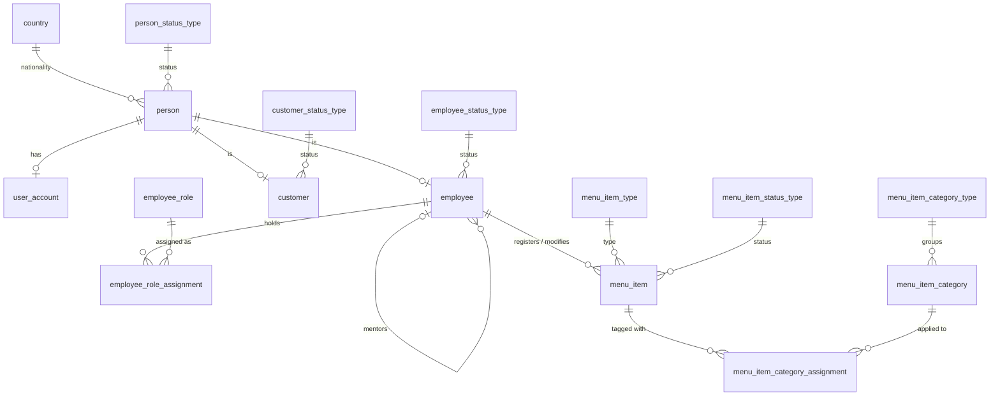
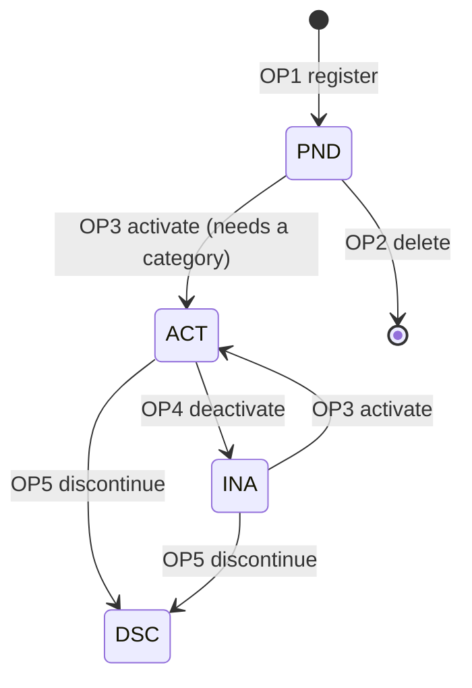

# Restaurant Database

A PostgreSQL schema for a restaurant: people (employees and customers), staff roles, user accounts and a menu with categories (allergens and ingredients). Business rules are enforced through constraints, triggers and a set of stored operations.

## Contents

| Script | Purpose |
|---|---|
| [`sql/01_schema/`](sql/01_schema) | Tables, constraints, indexes and reference data, split by area: `00_drop`, `01_people`, `02_employees`, `03_customers`, `04_menu` |
| [`sql/02_views.sql`](sql/02_views.sql) | Reporting views for the menu |
| [`sql/03_functions.sql`](sql/03_functions.sql) | Operations OP1–OP8 on menu items and an authentication helper |
| [`sql/04_triggers.sql`](sql/04_triggers.sql) | Business-rule and audit triggers |
| [`sql/05_sample_data.sql`](sql/05_sample_data.sql) | Fictional demo data |
| [`sql/install.sql`](sql/install.sql) | Runs everything above in order |

## Quick start

```bash
createdb restaurant
cd sql
psql -d restaurant -f install.sql
```

The scripts are re-runnable: `01_schema/00_drop.sql` drops and recreates every table.

## Data model



## Menu item lifecycle



Status codes: `PND` pending, `ACT` active, `INA` inactive, `DSC` discontinued.

## Operations

All operations identify the acting employee by e-mail (case-insensitive). When a precondition is not met the statement affects zero rows and no error is raised.

| Op | Function | Effect |
|---|---|---|
| OP1 | `fn_register_menu_item` | Create a menu item in status `PND` |
| OP2 | `fn_delete_menu_item` | Delete an item (only while `PND`) |
| OP3 | `fn_activate_menu_item` | `PND`/`INA` → `ACT` (requires at least one category) |
| OP4 | `fn_deactivate_menu_item` | `ACT` → `INA` |
| OP5 | `fn_discontinue_menu_item` | `ACT`/`INA` → `DSC` |
| OP6 | `fn_update_menu_item` | Change item data (only while `PND`/`INA`) |
| OP7 | `fn_add_menu_item_to_category` | Attach a category (only while `PND`/`INA`) |
| OP8 | `fn_remove_menu_item_from_category` | Detach a category (only while `PND`/`INA`) |
| – | `fn_is_manager` | Check e-mail + password of an active employee |

```sql
SELECT fn_register_menu_item(100, 'Tomato soup', 'Creamy soup', 5.90, 280,
                             'employee01@example.com', 'FOD');
SELECT fn_add_menu_item_to_category(100, 'VEG', 'employee01@example.com');
SELECT fn_activate_menu_item(100, 'employee01@example.com');
```

## Views

| View | Shows |
|---|---|
| `menu_item_details` | Every item with type, status, price, and who registered / last changed it |
| `active_and_inactive_menu_items` | Items in status `ACT` or `INA` |
| `menu_item_status_summary` | Item count per status |
| `menu_item_categories` | Categories of each item, labelled with their category type |

## Naming conventions

Tables and columns use `snake_case`. Constraint prefixes: `pk_`, `uk_` (unique), `fk_`, `chk_`; indexes `ix_` / `ux_`; triggers `tr_`; functions `fn_`. Code columns are always three upper-case letters.

| Reference table | Codes |
|---|---|
| `person_status_type`, `employee_status_type`, `customer_status_type` | `ACT` active · `PND` pending · `INA` inactive |
| `menu_item_status_type` | `ACT` · `PND` · `INA` · `DSC` discontinued |
| `menu_item_type` | `FOD` food · `DRK` drink · `OTH` other |
| `menu_item_category_type` | `ALG` allergen · `ING` ingredient |
| `employee_role` | `HDC` head chef · `CHF` cook · `WTR` waiter · `BAR` bartender · `SHS` shift supervisor · `CLN` cleaner |

## Known issues and notes

- **OP4 and OP5 are blocked by a trigger.** `fn_chk_menu_item_editable` rejects *any* update to an item whose status is not `PND`/`INA`, which also blocks the `ACT` → `INA` and `ACT` → `DSC` transitions. Allowing the change when the status column itself is being updated would fix it. The behaviour is kept as in the original design.
- **Passwords are stored in plain text** (`user_account.password`) and compared directly in `fn_is_manager`. Use salted hashes (e.g. `pgcrypto`) before any real use.
- `fn_is_manager` only checks that the employee and account are active; it does not check a manager role.
- The Estonian national-ID rule exists both as a `CHECK` constraint and as a trigger.
- The time zone `Europe/Tallinn` is hard-coded in range checks and audit triggers.

## Sample data

`05_sample_data.sql` contains only synthetic data: placeholder names ("Employee One", "Customer Two"), `example.com` e-mail addresses, made-up IDs and addresses, and demo passwords.
